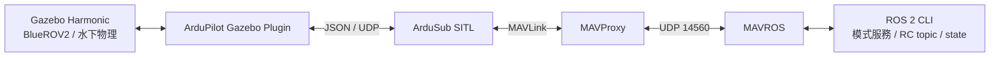

# AUV M1 — WSL2 / Gazebo Harmonic / ArduSub SITL / ROS 2

在 Windows 11 的 WSL2 Ubuntu 24.04 上，建立以 Gazebo Harmonic、ArduSub SITL 與 ROS 2 Jazzy 為核心的水下機器人模擬環境。

M1 的目前成果是：確認 NVIDIA GPU 繪圖加速、啟動水下場景與飛控模擬、完成基本運動測試，再透過 MAVROS 建立 ROS 2 指令與狀態回傳路徑。這是往 Command Manager、RViz 與操作介面發展的基礎。

**此環境從獨立的 `auv_m1` 目錄建立，沒有沿用舊 SAUVC 工作空間。倉庫名稱 `sauvc-auv` 不代表已整合競賽場景或任務。**

> 整理日期：2026-11-03。驗證依據為開發過程中保存的終端輸出與操作者回報；整理文件時未重新執行整套模擬。以下區分「已驗證」與「待驗證」，不把規劃當成完成。

## 1. 完成範圍

| 項目 | 狀態 | 證據或限制 |
| --- | --- | --- |
| Windows 11 / WSL2 / Ubuntu 24.04 | 已確認 | Ubuntu 發行版運行於 WSL2 |
| NVIDIA GPU 的 WSLg OpenGL 加速 | 已確認 | `D3D12 (NVIDIA GeForce RTX 5070 Ti)`、`Accelerated: yes` |
| Gazebo Harmonic | 已確認 | Gazebo Sim 8.15.0；畫面與水下模型成功顯示；模擬時間持續增加 |
| ArduSub SITL 編譯 | 已完成 | `sub finished successfully`；產出 `build/sitl/bin/ardusub` |
| ArduPilot Gazebo plugin 編譯 | 已完成 | 產出 `libArduPilotPlugin.so`；`ldd` 未列出缺少的依賴 |
| Gazebo ↔ ArduSub SITL | 已驗證 | 初始化、心跳、EKF 訊息，以及模型運動回報 |
| 基本前進、下潛 | 已驗證 | 透過 MAVProxy 控制，操作者回報成功 |
| ALT_HOLD 定深 | 初步通過 | 操作者回報成功；尚無深度誤差、漂移與長時間穩定性量測 |
| MAVProxy 週期計時警告 | 局部處理已驗證 | 專案包裝程式改用 monotonic 計時；人工觀察 30 秒無原警告 |
| ROS 2 ↔ MAVROS ↔ SITL 模式切換 | 已驗證 | `ALT_HOLD` / `MANUAL` 服務呼叫後，`/mavros/state` 回報實際模式 |
| ROS 2 中立 RC override | 已驗證 | 持續以 10 Hz 發布時，未解鎖狀態由 CRITICAL 回到 STANDBY |
| MAVROS TIMESYNC 警告 | 暫時繞過 | 設定 `NONE` 與 `timesync_rate=0.0`；不是整體時間同步驗收 |
| RViz2 啟動與 GPU 繪圖 | 已驗證 | 視窗能啟動；同一環境的 OpenGL renderer 為 NVIDIA D3D12 |
| `/mavros/local_position/pose`、`/mavros/imu/data` | 待驗證 | 已提出檢查指令，尚未收到資料輸出 |
| 經 ROS 控制下潛並讀取位置變化 | 待驗證 | 先前的運動測試使用 MAVProxy，不能等同 ROS 運動測試 |
| Gazebo ground truth → ROS topic | 待完成 | 尚未完成獨立的 Gazebo 真值橋接 |
| RViz 顯示艇體、動態姿態與 TF | 待完成 | 視窗開啟不等於資料整合完成 |
| Command Manager / 簡單操作介面 | 待完成 | 尚未實作 |
| 統一 ROS launch / 啟動包 | 暫停 | 目前以手動終端流程驗證最簡單 ROS loop |

## 2. 環境與版本紀錄

| 元件 | 本次環境紀錄 |
| --- | --- |
| 主機系統 | Windows 11 |
| WSL | WSL2；先前環境檢查紀錄為 WSL 2.6.3、WSLg 1.0.71 |
| Linux | Ubuntu 24.04，發行版名稱 `Ubuntu-24.04` |
| GPU | **NVIDIA GeForce RTX 5070 Ti** |
| ROS 2 | Jazzy |
| Gazebo | Harmonic / Gazebo Sim **8.15.0** |
| OpenGL | 4.6；Mesa **25.2.8-0ubuntu0.24.04.2**；D3D12 backend |
| Python | **3.12.3**，使用專案虛擬環境 |
| MAVProxy | **1.8.75** |
| pymavlink | **2.4.50** |
| ArduSub | **V4.8.0-dev**；開發版，並非正式穩定版 |
| SITL frame | `vectored`，`FRAME_CONFIG=1` |
| Gazebo 模型 | 社群 `clydemcqueen/bluerov2_gz` 的 BlueROV2 基本型 |

最初討論曾提到 RTX 3070 Ti；實際驗證與本文件採用的硬體為 **RTX 5070 Ti**。這裡驗證的是 WSLg 的 OpenGL 繪圖路徑，未進行 CUDA 或其他 GPU 運算驗收。[WSLg GPU 選擇說明](https://github.com/microsoft/wslg/wiki/GPU-selection-in-WSLg)

### 原始碼版本

| 上游專案 | 已記錄 commit |
| --- | --- |
| [ArduPilot/ardupilot](https://github.com/ArduPilot/ardupilot) | `7af20c9f238493a6b091dcda46c362dbdbe74360` |
| [ArduPilot/ardupilot_gazebo](https://github.com/ArduPilot/ardupilot_gazebo) | `082a0fe231f6e63bc8d1598f1cba461d9e2ea7f5` |
| [clydemcqueen/bluerov2_gz](https://github.com/clydemcqueen/bluerov2_gz) | **待從實機補記** |
| MAVROS | apt 安裝版本待補記 |

`bluerov2_gz` 上游將模型標示為概念驗證，不能視為自製艇已校準的水動力模型。質量、浮力、阻力與推進器參數都需要另行校準。[模型來源](https://github.com/clydemcqueen/bluerov2_gz)

## 3. 已驗證架構與後續方向



MAVProxy 除了命令列操作，也負責這次測試中的 MAVLink 轉送。MAVROS 把飛控資料與控制介面提供給 ROS 2。Gazebo Transport topic 與 ROS 2 topic 是不同的介面；Gazebo 能顯示模型，不代表已經存在 ROS ground-truth topic。

後續預計由 Command Manager 統一接受操作命令並發布控制訊號，RViz 接收位置、姿態、TF 與艇體描述。這些尚未整合到目前的手動流程。

## 4. 工作目錄

目前 WSL 實機路徑為 `/home/jason/AUV/auv_m1`；以下以 `~/AUV/auv_m1` 表示。GitHub 倉庫目錄名稱與實機路徑可以不同。

```text
~/AUV/auv_m1/
├── src/
│   ├── ardupilot/                  # 第三方 repo，含自己的 submodules
│   │   ├── venv-ardupilot/         # Python 環境，不上傳
│   │   └── build/sitl/bin/ardusub  # 編譯產物，不上傳
│   ├── ardupilot_gazebo/           # 第三方 repo
│   │   └── build/                 # 編譯產物，不上傳
│   └── bluerov2_gz/               # 第三方模型 repo
├── ros2_ws/
│   └── src/                       # 預留自有 ROS packages
├── models/                        # 預留自有模型
├── worlds/                        # 預留自有世界
├── scripts/
│   ├── gazebo_env.sh              # 本次手動流程使用
│   └── mavproxy_monotonic.py      # 本次計時 workaround
└── logs/
    └── gazebo_sitl/               # SITL 參數與執行紀錄，不上傳
```

本文件整理了既有腳本內容；不表示 GitHub 已包含實機目錄、第三方原始碼或編譯結果。之前另外草擬的 `start_*.sh` 啟動包仍暫停，未列為已部署流程。

## 5. WSL2 與 GPU 檢查

### Windows PowerShell

```powershell
wsl --version
wsl --list --verbose
nvidia-smi
```

Ubuntu 發行版應列為 `VERSION 2`。`nvidia-smi` 可補充主機驅動與 GPU 資訊；Gazebo / RViz 的實際 OpenGL 路徑仍需在 Linux 終端檢查。

### WSL Ubuntu

```bash
cat /etc/os-release
uname -r
source /opt/ros/jazzy/setup.bash
export GALLIUM_DRIVER=d3d12
export MESA_D3D12_DEFAULT_ADAPTER_NAME=NVIDIA
glxinfo -B
gz sim --versions
```

本次的重要輸出：

```text
direct rendering: Yes
Accelerated: yes
OpenGL renderer string: D3D12 (NVIDIA GeForce RTX 5070 Ti)
OpenGL core profile version string: 4.6 ... Mesa 25.2.8...
Gazebo Sim: 8.15.0
```

若 renderer 顯示 `llvmpipe`，先在**實際啟動 Gazebo / RViz 的同一個終端**確認環境變數。這次曾觀察到未載入平常 shell 設定的終端採用軟體 renderer；載入專案環境後成功使用 D3D12。`Microsoft Corporation` vendor 搭配 NVIDIA D3D12 renderer 是這次的正常輸出。

基本畫面測試：

```bash
gz sim -v4 -r shapes.sdf
```

停止此測試後，再啟動水下場景。

## 6. 建置紀錄

這一節是本次環境的建置摘要，不是已在乾淨主機重新驗證的自動安裝器。Windows / WSL2 / Ubuntu 與 ROS 2 Jazzy 的初始安裝已先完成。

### 6.1 系統依賴

Gazebo 走 Jazzy 的 `ros_gz` / vendor package 路徑。Ubuntu 24.04、Jazzy、Harmonic 是本專案使用的配對。[Gazebo 與 ROS 安裝說明](https://gazebosim.org/docs/harmonic/ros_installation/)

相關安裝命令整理如下；既有環境不需要為了閱讀本文件重裝：

```bash
sudo apt update
sudo apt install git build-essential cmake pkg-config python3-venv mesa-utils \
  ros-jazzy-ros-gz ros-jazzy-rviz2 ros-jazzy-mavros geographiclib-tools \
  rapidjson-dev libopencv-dev \
  libgstreamer1.0-dev libgstreamer-plugins-base1.0-dev
sudo geographiclib-get-geoids egm96-5
```

ArduPilot 的完整建置依賴由其官方先備環境腳本處理，不能只靠以上清單。這次使用自有 venv，先備腳本曾以以下選項執行，避免另外建立 Python 環境與不需要的圖形工具：

```bash
# 在已 clone 的 src/ardupilot 內執行；此步會安裝系統依賴。
SKIP_AP_GRAPHIC_ENV=1 \
SKIP_AP_COV_ENV=1 \
SKIP_AP_COMPLETION_ENV=1 \
DO_AP_STM_ENV=0 \
DO_PYTHON_VENV_ENV=0 \
bash Tools/environment_install/install-prereqs-ubuntu.sh
```

全新機建置時仍需依指定 commit 的腳本與安裝輸出處理依賴。[ArduPilot Linux 建置環境](https://ardupilot.org/dev/docs/building-setup-linux.html)

### 6.2 原始碼與版本

以下 clone 命令適用於尚未建立這些目錄的新工作區；已存在的 repo 先檢查 `git status`，不要直接覆蓋或切換版本：

```bash
mkdir -p ~/AUV/auv_m1/{src,ros2_ws/src,models,worlds,scripts,logs}
cd ~/AUV/auv_m1/src
git clone --recurse-submodules https://github.com/ArduPilot/ardupilot.git
git clone https://github.com/ArduPilot/ardupilot_gazebo.git
git clone https://github.com/clydemcqueen/bluerov2_gz.git
```

以上預設分支會隨時間改變。若要重現本次已知版本，僅在新 clone、沒有本地修改的 repo 使用：

```bash
git -C ~/AUV/auv_m1/src/ardupilot checkout 7af20c9f238493a6b091dcda46c362dbdbe74360
git -C ~/AUV/auv_m1/src/ardupilot submodule update --init --recursive
git -C ~/AUV/auv_m1/src/ardupilot_gazebo checkout 082a0fe231f6e63bc8d1598f1cba461d9e2ea7f5
```

BlueROV2 commit 與全部 apt 版本尚未鎖定，因此目前不能宣稱完整可重現。

### 6.3 ArduSub SITL

這次的 Python 環境與編譯指令：

```bash
cd ~/AUV/auv_m1/src/ardupilot
python3 -m venv --system-site-packages venv-ardupilot
source venv-ardupilot/bin/activate
python -m pip install 'MAVProxy==1.8.75' 'pymavlink==2.4.50' pexpect
python -c "import pymavlink, pexpect; print('SITL Python dependencies OK')"
./waf configure --board sitl
./waf sub -j4
ls -lh build/sitl/bin/ardusub
```

驗證結果：`sub finished successfully`，可執行檔約 5.4 MiB。系統與先備腳本提供其他必要建置依賴；上面三個 pip 套件不是完整的凍結依賴清單。

### 6.4 ArduPilot Gazebo plugin

在已備妥 Gazebo 開發依賴的環境：

```bash
source /opt/ros/jazzy/setup.bash
export GZ_VERSION=harmonic
cd ~/AUV/auv_m1/src/ardupilot_gazebo
cmake -S . -B build -DCMAKE_BUILD_TYPE=RelWithDebInfo
cmake --build build --parallel 4
ls -lh build/libArduPilotPlugin.so
ldd build/libArduPilotPlugin.so | grep 'not found'
```

結果：plugin 編譯成功，共享函式庫約 9.0 MiB；最後一行沒有輸出，表示該次 `ldd` 未列出找不到的函式庫。此專案透過 ROS 環境取得 Gazebo library 路徑；若 CMake 找不到 `gz-sim8`，先確認 Jazzy 環境與 vendor 開發套件。[官方 plugin 建置說明](https://github.com/ArduPilot/ardupilot_gazebo)

## 7. 手動啟動與最簡單 ROS loop

以下流程以已完成建置的實機為基礎。命令分別註明在 Ubuntu shell 或 MAVProxy 提示符輸入。

### 終端 A：Gazebo

既有 `scripts/gazebo_env.sh` 內容見附錄 A。

```bash
source ~/AUV/auv_m1/scripts/gazebo_env.sh
gz sim -v4 -r bluerov2_underwater.world
```

確認水下模型出現且模擬時間持續增加。本次使用 BlueROV2 基本型，搭配 `vectored`；不要與 Heavy / `vectored_6dof` 混用。[模型啟動說明](https://github.com/clydemcqueen/bluerov2_gz#running-gazebo)

### 終端 B：ArduSub SITL + MAVProxy

既有 `scripts/mavproxy_monotonic.py` 內容見附錄 B，需具備可執行權限。

```bash
cd ~/AUV/auv_m1/src/ardupilot
source venv-ardupilot/bin/activate
MAVPROXY_CMD="$HOME/AUV/auv_m1/scripts/mavproxy_monotonic.py" \
python Tools/autotest/sim_vehicle.py \
  -v ArduSub -f vectored --model JSON -L RATBeach \
  --no-rebuild --no-rcin \
  --use-dir ~/AUV/auv_m1/logs/gazebo_sitl
```

`--no-rcin` 避免這次 MAVProxy 控制測試走模擬 RCUDP 輸入；控制改由 MAVLink 傳入。不要在每次啟動加入 `-w`，因為它會清除 SITL 保存的參數。本流程不自動解鎖。

等待初始化後，在 **MAVProxy** 輸入：

```text
param show FRAME_CONFIG
status HEARTBEAT
output add 127.0.0.1:14560
```

`FRAME_CONFIG` 的本次紀錄為 `1`。`output add` 在每次新啟動的 MAVProxy session 加一次即可，供下一個終端的 MAVROS 使用。

若之前使用 MAVProxy 持續送 RC，在交由 ROS 前先檢查 `rc status`。本次 ROS 測試開始時，MAVProxy 的 override 通道均為 `0 (no override)`，避免兩個控制來源互相覆蓋；必要時逐一使用 `rc 1 0` 至 `rc 6 0` 釋放。

### 終端 C：MAVROS

使用一般 ROS 終端，無需啟用 ArduPilot 的 Python venv：

```bash
source /opt/ros/jazzy/setup.bash
ros2 run mavros mavros_node --ros-args \
  --params-file /opt/ros/jazzy/share/mavros/launch/apm_config.yaml \
  --params-file /opt/ros/jazzy/share/mavros/launch/apm_pluginlists.yaml \
  -p fcu_url:='udp://127.0.0.1:14560@' \
  -p tgt_system:=1 -p tgt_component:=1 \
  -p system_id:=255 -p component_id:=240
```

這次測試明確設定 MAVROS 自身的來源 system ID 為 `255`，目標飛控為 `1`。曾只在連線 URL 設 `ids`，但 `/mavros` 的 `system_id` 仍為 `1`；因此採用以上啟動參數。來源 ID 與目標 ID 不要混為一談。

### 終端 D：暫時停用 MAVROS TIMESYNC，確認連線

```bash
source /opt/ros/jazzy/setup.bash
ros2 param get /mavros system_id
ros2 param set /mavros/time timesync_mode NONE
ros2 param set /mavros/time timesync_rate 0.0
ros2 param get /mavros/time timesync_mode
ros2 param get /mavros/time timesync_rate
ros2 topic echo /mavros/state --once
```

預期來源 `system_id=255`、`connected: true`、`armed: false`。這兩個時間參數是本次的 runtime workaround，重啟後要重新確認；尚未整理成正式啟動設定。停用 TIMESYNC 不代表各 topic 時間戳已精準一致。

### 終端 E：持續送中立 RC 訊號

保持未解鎖，在單獨的 ROS 終端持續執行：

```bash
source /opt/ros/jazzy/setup.bash
ros2 topic pub --rate 10 /mavros/rc/override mavros_msgs/msg/OverrideRCIn \
  '{channels: [1500, 1500, 1500, 1500, 1500, 1500, 65535, 65535, 65535, 65535, 65535, 65535, 65535, 65535, 65535, 65535, 65535, 65535]}'
```

前六個通道在這次設定中以 `1500` 作為中立；其餘通道 `65535` 表示不改動。本步驟驗證控制訊號持續抵達，不進行解鎖或推進器運動。

回到終端 D 檢查：

```bash
ros2 topic info /mavros/rc/override
ros2 topic echo /mavros/state --once
```

已觀察到的健康狀態：

```yaml
connected: true
armed: false
mode: MANUAL
system_status: 3
```

停止這個發布器後，本次環境會回到 `system_status: 5`，與先前 `Lost manual control` 及 pilot-input watchdog 的觀察一致。它不表示 ROS 連線一定中斷。不要把關閉失效保護當作修復；未來 Command Manager 需要定期發布中立命令，並讓輸入中斷時保留失效保護行為。

### 終端 D：模式切換與狀態回讀

```bash
ros2 service call /mavros/set_mode mavros_msgs/srv/SetMode \
  "{base_mode: 0, custom_mode: 'ALT_HOLD'}"
ros2 topic echo /mavros/state --once

ros2 service call /mavros/set_mode mavros_msgs/srv/SetMode \
  "{base_mode: 0, custom_mode: 'MANUAL'}"
ros2 topic echo /mavros/state --once
```

已驗證服務回應 `mode_sent: true`，且 state 分別顯示 `ALT_HOLD` / `MANUAL`。應以實際 state 作為切換結果；單看 `mode_sent` 不能當成飛控已完成切換。這是目前已通過的最簡單 ROS 指令與狀態回讀測試。

## 8. 資料 topic 與 RViz：下一個驗收點

目前已驗證 `/mavros/state`。以下位置與 IMU 命令尚待在實機貼回輸出：

```bash
source /opt/ros/jazzy/setup.bash
timeout 8s ros2 topic echo /mavros/local_position/pose \
  --qos-reliability best_effort --once
timeout 8s ros2 topic echo /mavros/imu/data \
  --qos-reliability best_effort --once
```

| 介面 | 用途 | 目前狀態 |
| --- | --- | --- |
| `/mavros/state` | 連線、解鎖、模式與 MAV_STATE | 已驗證 |
| `/mavros/rc/override` | ROS 發送 RC override | 已驗證中立持續發布 |
| `/mavros/set_mode` | 模式切換服務 | 已驗證 |
| `/mavros/local_position/pose` | 飛控估計位置與姿態 | 待確認訊息與頻率 |
| `/mavros/imu/data` | IMU 姿態、角速度、加速度 | 待確認訊息與頻率 |
| ROS `/clock` | Gazebo 模擬時間橋接 | 待完成 |
| ROS Gazebo ground-truth pose | 模擬真值 | 待完成 |
| ROS `/tf` 與艇體描述 | RViz 動態顯示 | 待完成 |

MAVROS local position 採 ENU 座標，`z` 向上；原點是飛控估計系統的原點，不能直接視為水面零深度，也不能直接與 Gazebo world 座標相減。後續需定義 frame、原點及時間基準。[MAVROS local_position 實作](https://github.com/mavlink/mavros/blob/ros2/mavros/src/plugins/local_position.cpp)

RViz 視窗測試：

```bash
source ~/AUV/auv_m1/scripts/gazebo_env.sh
rviz2
```

此命令已能開啟視窗；尚未提供經驗證的 RViz 設定檔、URDF 或 TF tree。

## 9. 問題排查紀錄

### MAVProxy：`Warning, time moved backwards. Restarting timer.`

已確認當時的 `pymavlink.mavutil.periodic_event` 使用 `time.time()`。WSL 的 10 秒 wall-clock 檢測沒有量到倒退，NTP 顯示啟用且已同步，clocksource 為 `tsc`；因此沒有足夠證據判定 OS 時鐘是根因。

處理方式是附錄 B 的專案包裝程式，只替 MAVProxy 使用的週期事件改用 `time.monotonic()`。啟動訊息為 `[AUV M1] MAVProxy periodic timers: monotonic`，操作者確認其後 30 秒未再出現原警告。未修改全域 `time.time()`、套件檔案或 Windows / WSL 校時設定。

### MAVROS：`TM: Time jump detected. Resetting time synchroniser.`

這是 MAVROS 時間同步器的訊息，與上一項不是同一段程式碼。暫以 `/mavros/time` 的 `timesync_mode=NONE`、`timesync_rate=0.0` 繼續基本 ROS loop；操作者確認設定成功。最後貼出的警告時間早於 `Timesync mode: NONE` 訊息。

後續加入 Gazebo `/clock`、`use_sim_time`、TF 或感測融合之前，仍需重新設計並驗證共同時間基準。這個 workaround 不能當成時間同步已修復。[MAVROS 時間同步實作](https://github.com/mavlink/mavros/blob/ros2/mavros/src/plugins/sys_time.cpp)

### `system_status` 在 3 與 5 之間切換

`3` 是 STANDBY，`4` 是 ACTIVE，`5` 是 CRITICAL。這次在未解鎖時，持續中立控制能維持 `3`；停止輸入後回到 `5`。但 `5` 本身不能唯一定位故障，仍要一起看 flight-controller 訊息、連線、輸入與其他 failsafe。[ArduSub failsafe 實作](https://github.com/ArduPilot/ardupilot/blob/master/ArduSub/failsafe.cpp)

### SRTM 檔案解碼與 terrain 模組

曾出現 `Failed to download /SRTM3/filelist_python` 的 UTF-8 解碼訊息。單憑這段訊息不能認定水下物理或 SITL 編譯失敗；這次仍完成初始化與運動測試。根因與完整修復尚未確認。

曾嘗試 `module unload terrain`，但收到 `Unable to find module terrain`，所以不能把「成功卸載 terrain」列為已完成處理。

### `exit` 無法關閉 MAVProxy

本次輸入 `exit` 得到 `Unknown command 'exit'`。目前採用啟動 SITL 的終端機按 `Ctrl+C` 停止，不依賴該命令。

### Ubuntu 的 `cls`

`cls` 是 Windows 常見命令；Ubuntu 清畫面可用 `clear` 或 `Ctrl+L`。這不影響建置與模擬。

## 10. 停止流程

1. 若曾解鎖，先把控制恢復中立，再在 MAVProxy 輸入 `disarm`，確認已解除解鎖；保持中立發布器運行直到此步完成。
2. 在 SITL 啟動終端按 `Ctrl+C`，等 shell 提示符返回。
3. 在 RC 發布器及 MAVROS 終端分別按 `Ctrl+C`。
4. 關閉 Gazebo 視窗；若啟動終端仍未返回，再按 `Ctrl+C`。
5. 關閉 RViz 視窗或在它的終端按 `Ctrl+C`。

以上針對這份 SITL 流程；不是實艇操作或緊急停止程序。

## 11. GitHub 保存方式

此倉庫優先保存 README、自有腳本、設定、ROS packages 與經整理的驗證紀錄。第三方 repo 以來源網址及 commit 記錄，不把整個 clone 直接加入本專案。

適合追蹤：

- 本文件、`docs/` 內的人工整理紀錄。
- 自有 `scripts/`、`config/` 與之後的 `ros2_ws/src/` packages。
- 有明確來源及授權的自有或修改後模型、world、RViz 設定。
- 去除個人資訊後的短版測試摘要。

排除項目：Python venv、`build/`、`install/`、ROS `log/`、SITL `logs/`、`.tlog`、`.BIN`、rosbag、快取、個人憑證，以及 `src/` 下三個第三方 repo。`.gitignore.example` 是對應目前工作目錄的範本；套用前需確認沒有要追蹤的實驗資料。

第三方來源與授權維持各自上游規定。本次沒有替所有上游程式碼或模型另行指定統一授權；新增 LICENSE 前需先決定自有程式碼授權及確認第三方資產條件。

### 補齊實機版本證據

在 WSL 執行，將確認過的結果摘錄到 `docs/`，不需要把整個日誌上傳：

```bash
git -C ~/AUV/auv_m1/src/ardupilot rev-parse HEAD
git -C ~/AUV/auv_m1/src/ardupilot_gazebo rev-parse HEAD
git -C ~/AUV/auv_m1/src/bluerov2_gz rev-parse HEAD
git -C ~/AUV/auv_m1/src/bluerov2_gz status --short
dpkg-query -W ros-jazzy-mavros ros-jazzy-mavros-msgs ros-jazzy-ros-gz
~/AUV/auv_m1/src/ardupilot/venv-ardupilot/bin/python -m pip freeze
```

提交前使用 `git status --short` 與 `git diff --cached --stat` 檢查清單；忽略規則不會自動移除已被追蹤的檔案。

## 12. 後續工作

- [ ] 補記 BlueROV2 commit、MAVROS 與 apt 套件版本。
- [ ] 確認位置 / IMU topic 有資料，量測頻率及時間戳連續性。
- [ ] 在 SITL 完成一次 ROS 控制運動與位置回讀測試，記錄起迄位置。
- [ ] 建立 Gazebo 真值的 ROS 橋接，定義座標轉換與原點。
- [ ] 統一 Gazebo、ROS、MAVROS 與 RViz 的時間基準。
- [ ] 建立 RViz 顯示、艇體描述及 TF。
- [ ] 實作 Command Manager：單一控制來源、輸入驗證、中立持續發布、狀態回讀與失聯處理。
- [ ] 加入簡單操作介面。
- [ ] 基本 ROS loop 通過後，再恢復統一 launch / 啟動包工作。
- [ ] 使用乾淨環境驗證文件的重建流程，加入量化定深測試。

## 附錄 A：本次使用的 `scripts/gazebo_env.sh`

以下為既有手動設定的整理，不是已完成測試的新啟動包。若需還原，存為對應檔案後使用 `source` 載入：

```bash
source /opt/ros/jazzy/setup.bash
export GZ_VERSION=harmonic
export GALLIUM_DRIVER=d3d12
export MESA_D3D12_DEFAULT_ADAPTER_NAME=NVIDIA
export GZ_SIM_SYSTEM_PLUGIN_PATH="$HOME/AUV/auv_m1/src/ardupilot_gazebo/build${GZ_SIM_SYSTEM_PLUGIN_PATH:+:$GZ_SIM_SYSTEM_PLUGIN_PATH}"
export GZ_SIM_RESOURCE_PATH="$HOME/AUV/auv_m1/src/bluerov2_gz/models:$HOME/AUV/auv_m1/src/bluerov2_gz/worlds${GZ_SIM_RESOURCE_PATH:+:$GZ_SIM_RESOURCE_PATH}"
```

## 附錄 B：本次使用的 `scripts/mavproxy_monotonic.py`

這個 wrapper 保持一般 MAVProxy 啟動流程，只替換該程序使用的週期事件類別；不自動解鎖，也不自動送中立 RC。ROS 測試所需的中立訊號由第 7 節單獨的發布器提供。

```python
#!/usr/bin/env python3
import runpy
import time
from pathlib import Path
from pymavlink import mavutil


class MonotonicPeriodicEvent(mavutil.periodic_event):
    def __init__(self, frequency):
        self.frequency = float(frequency)
        self.last_time = time.monotonic()

    def trigger(self):
        now = time.monotonic()
        if now < self.last_time:
            print("[AUV M1] Monotonic clock moved backwards", flush=True)
            self.last_time = now
        if self.last_time + 1.0 / self.frequency <= now:
            self.last_time = now
            return True
        return False


mavutil.periodic_event = MonotonicPeriodicEvent
root = Path(__file__).resolve().parents[1]
original = root / "src/ardupilot/venv-ardupilot/bin/mavproxy.py"
print("[AUV M1] MAVProxy periodic timers: monotonic", flush=True)
runpy.run_path(str(original), run_name="__main__")
```

存檔後的權限設定：

```bash
chmod +x ~/AUV/auv_m1/scripts/mavproxy_monotonic.py
```

## 參考來源

- [Microsoft：WSLg GPU selection](https://github.com/microsoft/wslg/wiki/GPU-selection-in-WSLg)
- [Gazebo：Harmonic 與 ROS 安裝配對](https://gazebosim.org/docs/harmonic/ros_installation/)
- [ArduPilot：Linux 建置環境](https://ardupilot.org/dev/docs/building-setup-linux.html)
- [ArduPilot：Gazebo plugin](https://github.com/ArduPilot/ardupilot_gazebo)
- [BlueROV2 Gazebo Harmonic 社群模型](https://github.com/clydemcqueen/bluerov2_gz)
- [MAVROS：ROS 2 專案文件](https://github.com/mavlink/mavros/tree/ros2)
- [Python：time.monotonic](https://docs.python.org/3.12/library/time.html#time.monotonic)

環境狀態以本專案的版本與測試紀錄為準；上游文件會更新。
